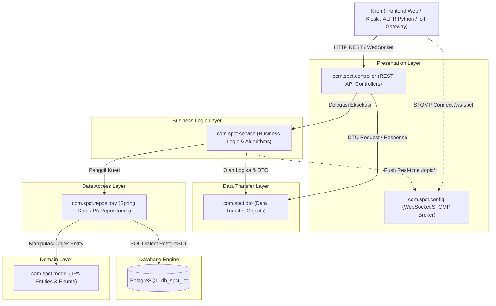

# 02. Arsitektur Folder dan Tanggung Jawab Komponen Backend SPCT

Dokumentasi ini menyajikan pembagian tugas dan tanggung jawab (*Separation of Concerns*) dari seluruh folder/package pada sistem backend **Sistem Parkir Cerdas Terintegrasi IoT (SPCT)** yang dibangun dengan arsitektur berlapis (*Layered Architecture*) menggunakan framework **Spring Boot 3**.

---

## 1. Ikhtisar Arsitektur Berlapis (Layered Architecture)

Sistem backend SPCT memisahkan logika aplikasi menjadi beberapa lapisan independen agar kode mudah diuji (*testable*), mudah dirawat (*maintainable*), dan memiliki keterikatan yang rendah (*loose coupling*):



---

## 2. Struktur Folder & Matriks Penanggung Jawab

Root package backend berada pada direktori:
`backend-spring/src/main/java/com/spct/`

| Folder / Package | Tanggung Jawab Utama | Jumlah File | Dependensi Keluar (*Depends on*) |
| :--- | :--- | :---: | :--- |
| `[root]` | Titik awal bootstrapping aplikasi, penjadwalan cron, dan master data seeder otomatis. | 1 file | `model`, `repository` |
| `config` | Konfigurasi infrastruktur perantara (protokol komunikasi WebSocket STOMP dan message broker). | 1 file | Framework Spring Messaging |
| `controller` | Gerbang penerima request HTTP (REST API), validasi parameter, dan penentu HTTP response status. | 8 file | `service`, `dto`, `model`, `repository` |
| `dto` | Kontrak transfer data antar layer (klien-ke-server dan controller-ke-service) tanpa mengekspos tabel database secara mentah. | 8 file | `model` (Enum) |
| `model` | Definisi domain bisnis, pemetaan skema tabel database (JPA Entity), dan konstanta enumerasi (Enum). | 17 file | Standar Java Persistence API (Jakarta Persistence) |
| `repository` | Abstraksi akses basis data PostgreSQL berbasis antarmuka (*Interface*) Spring Data JPA dan kueri JPQL kustom. | 10 file | `model` |
| `service` | Otak sistem yang memproses seluruh kalkulasi bisnis, algoritma heuristik A*, manajemen tarif, agregasi analitik, dan generator dokumen. | 9 file | `repository`, `model`, `dto`, Apache POI, iText |

---

## 3. Rincian Tanggung Jawab Setiap Folder

### 3.1. Package Root (`com.spct`)
- **Penanggung Jawab**: Titik masuk (*Entry Point*) eksekusi backend.
- **Berkas**: [`SpctApplication.java`](file:///d:/Proyek%20Perangkat%20Lunak/Aplikasi/Desktop/Sistem%20Parkir%20Cerdas%20Terintegrasi%20IoT/backend-spring/src/main/java/com/spct/SpctApplication.java)
- **Fungsi Utama**:
  1. Menginisiasi Spring ApplicationContext dan konfigurasi otomatis (*Auto-Configuration*).
  2. Mengaktifkan penjadwalan tugas berkala (`@EnableScheduling`) untuk pembersihan data retensi.
  3. Menyediakan komponen seeder data (`@Bean CommandLineRunner`) yang menjamin ketersediaan data master saat sistem pertama kali dijalankan (3 akun pengguna dengan NIP, 96 slot parkir multi-lantai, 4 kamera ANPR, dan 96 sensor ultrasonik).

---

### 3.2. Package `config` (`com.spct.config`)
- **Penanggung Jawab**: Pengaturan komunikasi jaringan real-time berbasis WebSocket STOMP.
- **Berkas**: [`WebSocketConfig.java`](file:///d:/Proyek%20Perangkat%20Lunak/Aplikasi/Desktop/Sistem%20Parkir%20Cerdas%20Terintegrasi%20IoT/backend-spring/src/main/java/com/spct/config/WebSocketConfig.java)
- **Fungsi Utama**:
  1. Mendaftarkan handshake endpoint `/ws-spct` dengan dukungan fallback SockJS ([WebSocketConfig.java:L42-L44](file:///d:/Proyek%20Perangkat%20Lunak/Aplikasi/Desktop/Sistem%20Parkir%20Cerdas%20Terintegrasi%20IoT/backend-spring/src/main/java/com/spct/config/WebSocketConfig.java#L42-L44)).
  2. Mengaktifkan *Simple In-Memory Message Broker* dengan prefix `/topic` untuk penyiaran pembaruan status denah (`/topic/monitoring`) dan peringatan penyerobotan slot (`/topic/anomali`) ([WebSocketConfig.java:L25](file:///d:/Proyek%20Perangkat%20Lunak/Aplikasi/Desktop/Sistem%20Parkir%20Cerdas%20Terintegrasi%20IoT/backend-spring/src/main/java/com/spct/config/WebSocketConfig.java#L25)).

---

### 3.3. Package `controller` (`com.spct.controller`)
- **Penanggung Jawab**: Mengatur antarmuka komunikasi eksternal (REST API) untuk Frontend Web, Kiosk Terminal, Python OCR microservice, dan IoT Hardware Gateways.
- **Daftar Berkas & Tanggung Jawab**:
  1. [`DeteksiPlatController.java`](file:///d:/Proyek%20Perangkat%20Lunak/Aplikasi/Desktop/Sistem%20Parkir%20Cerdas%20Terintegrasi%20IoT/backend-spring/src/main/java/com/spct/controller/DeteksiPlatController.java): Gerbang masuk dan keluar kendaraan, memvalidasi confidence score OCR, menerima transaksi simulasi Kiosk, dan menyediakan antrean keluar FIFO.
  2. [`AlokasiRuteController.java`](file:///d:/Proyek%20Perangkat%20Lunak/Aplikasi/Desktop/Sistem%20Parkir%20Cerdas%20Terintegrasi%20IoT/backend-spring/src/main/java/com/spct/controller/AlokasiRuteController.java): Endpoint pengalokasian slot dan pencarian rute shortest-path A* untuk kendaraan masuk.
  3. [`TransaksiPembayaranController.java`](file:///d:/Proyek%20Perangkat%20Lunak/Aplikasi/Desktop/Sistem%20Parkir%20Cerdas%20Terintegrasi%20IoT/backend-spring/src/main/java/com/spct/controller/TransaksiPembayaranController.java): Endpoint kalkulasi tarif parkir resmi dan konfirmasi pembayaran non-tunai.
  4. [`MonitoringFisikController.java`](file:///d:/Proyek%20Perangkat%20Lunak/Aplikasi/Desktop/Sistem%20Parkir%20Cerdas%20Terintegrasi%20IoT/backend-spring/src/main/java/com/spct/controller/MonitoringFisikController.java): Webhook penerima sinyal sensor IoT dari Raspberry Pi, daftar anomali aktif, dan tindakan penyelesaian anomali oleh petugas.
  5. [`AnalitikLaporanController.java`](file:///d:/Proyek%20Perangkat%20Lunak/Aplikasi/Desktop/Sistem%20Parkir%20Cerdas%20Terintegrasi%20IoT/backend-spring/src/main/java/com/spct/controller/AnalitikLaporanController.java): Penyedia metrik ringkasan harian/bulanan dan data seri waktu okupansi untuk grafik Dashboard Manajemen.
  6. [`LaporanController.java`](file:///d:/Proyek%20Perangkat%20Lunak/Aplikasi/Desktop/Sistem%20Parkir%20Cerdas%20Terintegrasi%20IoT/backend-spring/src/main/java/com/spct/controller/LaporanController.java): Pratinjau laporan operasional, pengunduhan dokumen resmi PDF/XLSX, riwayat audit trail unduhan, dan manajemen retensi manual.
  7. [`HardwareStatusController.java`](file:///d:/Proyek%20Perangkat%20Lunak/Aplikasi/Desktop/Sistem%20Parkir%20Cerdas%20Terintegrasi%20IoT/backend-spring/src/main/java/com/spct/controller/HardwareStatusController.java): Pemantauan status live hardware IoT (kamera ANPR & sensor ultrasonik) dan pengubahan status operasional ON/OFF.
  8. [`AuthController.java`](file:///d:/Proyek%20Perangkat%20Lunak/Aplikasi/Desktop/Sistem%20Parkir%20Cerdas%20Terintegrasi%20IoT/backend-spring/src/main/java/com/spct/controller/AuthController.java): Layanan autentikasi akun petugas/manajer berdasarkan NIP atau Username, serta reset kata sandi mandiri.

---

### 3.4. Package `dto` (`com.spct.dto`)
- **Penanggung Jawab**: Membentuk kontrak payload request dan response antara backend dan frontend.
- **Karakteristik**: Berisi POJO murni (*Plain Old Java Object*) tanpa anotasi JPA database, mengisolasi data sensitif internal sistem dari akses publik.
- **Daftar Berkas & Tanggung Jawab**:
  1. [`DataDashboardDto.java`](file:///d:/Proyek%20Perangkat%20Lunak/Aplikasi/Desktop/Sistem%20Parkir%20Cerdas%20Terintegrasi%20IoT/backend-spring/src/main/java/com/spct/dto/DataDashboardDto.java): Memuat seluruh data kartu KPI eksekutif, grafik okupansi per jam, dan grafik pendapatan harian.
  2. [`HasilAlokasiRuteDto.java`](file:///d:/Proyek%20Perangkat%20Lunak/Aplikasi/Desktop/Sistem%20Parkir%20Cerdas%20Terintegrasi%20IoT/backend-spring/src/main/java/com/spct/dto/HasilAlokasiRuteDto.java): Payload hasil alokasi slot (ID slot, lantai, koordinat) dan kumpulan simpul rute panduan.
  3. [`HasilDeteksiMasukDto.java`](file:///d:/Proyek%20Perangkat%20Lunak/Aplikasi/Desktop/Sistem%20Parkir%20Cerdas%20Terintegrasi%20IoT/backend-spring/src/main/java/com/spct/dto/HasilDeteksiMasukDto.java): Payload konfirmasi tiket masuk di Kiosk gerbang masuk (nomor tiket, rute panduan, waktu masuk).
  4. [`HasilDeteksiKeluarDto.java`](file:///d:/Proyek%20Perangkat%20Lunak/Aplikasi/Desktop/Sistem%20Parkir%20Cerdas%20Terintegrasi%20IoT/backend-spring/src/main/java/com/spct/dto/HasilDeteksiKeluarDto.java): Payload transaksi gerbang keluar (durasi parkir riil/simulasi, total tagihan, status saldo e-wallet).
  5. [`HasilTagihanDto.java`](file:///d:/Proyek%20Perangkat%20Lunak/Aplikasi/Desktop/Sistem%20Parkir%20Cerdas%20Terintegrasi%20IoT/backend-spring/src/main/java/com/spct/dto/HasilTagihanDto.java): Data rincian penagihan tarif parkir untuk antarmuka kasir/pembayaran mandiri.
  6. [`LaporanResponseDto.java`](file:///d:/Proyek%20Perangkat%20Lunak/Aplikasi/Desktop/Sistem%20Parkir%20Cerdas%20Terintegrasi%20IoT/backend-spring/src/main/java/com/spct/dto/LaporanResponseDto.java): Struktur data komposit untuk pratinjau laporan multi-kategori (Finansial, Operasional, Lingkungan, Komprehensif).
  7. [`ResolusiAnomaliRequestDto.java`](file:///d:/Proyek%20Perangkat%20Lunak/Aplikasi/Desktop/Sistem%20Parkir%20Cerdas%20Terintegrasi%20IoT/backend-spring/src/main/java/com/spct/dto/ResolusiAnomaliRequestDto.java): Payload input dari petugas saat menyelesaikan status anomali penyerobotan slot.
  8. [`TitikRuteDto.java`](file:///d:/Proyek%20Perangkat%20Lunak/Aplikasi/Desktop/Sistem%20Parkir%20Cerdas%20Terintegrasi%20IoT/backend-spring/src/main/java/com/spct/dto/TitikRuteDto.java): Koordinat simpul 2D `(x, y)` untuk merender garis rute navigasi visual pada denah Kiosk.

---

### 3.5. Package `model` (`com.spct.model`)
- **Penanggung Jawab**: Mendefinisikan entitas objek yang dipetakan langsung ke tabel-tabel PostgreSQL (*Object-Relational Mapping* / ORM) serta tipe enumerasi tetap.
- **Rincian Entitas (10 Entitas JPA)**:
  - [`User.java`](file:///d:/Proyek%20Perangkat%20Lunak/Aplikasi/Desktop/Sistem%20Parkir%20Cerdas%20Terintegrasi%20IoT/backend-spring/src/main/java/com/spct/model/User.java): Tabel `users` untuk data akun staf dan kredensial NIP.
  - [`DataKendaraan.java`](file:///d:/Proyek%20Perangkat%20Lunak/Aplikasi/Desktop/Sistem%20Parkir%20Cerdas%20Terintegrasi%20IoT/backend-spring/src/main/java/com/spct/model/DataKendaraan.java): Tabel `data_kendaraan` untuk master plat nomor dan jenis kendaraan.
  - [`SlotParkir.java`](file:///d:/Proyek%20Perangkat%20Lunak/Aplikasi/Desktop/Sistem%20Parkir%20Cerdas%20Terintegrasi%20IoT/backend-spring/src/main/java/com/spct/model/SlotParkir.java): Tabel `slot_parkir` untuk status fisik slot, koordinat grid, dan kendaraan yang sedang parkir.
  - [`TransaksiParkir.java`](file:///d:/Proyek%20Perangkat%20Lunak/Aplikasi/Desktop/Sistem%20Parkir%20Cerdas%20Terintegrasi%20IoT/backend-spring/src/main/java/com/spct/model/TransaksiParkir.java): Tabel `transaksi_parkir` untuk sesi parkir (waktu masuk, waktu tiba, waktu keluar, durasi, tagihan, dan menit dihemat).
  - [`Pembayaran.java`](file:///d:/Proyek%20Perangkat%20Lunak/Aplikasi/Desktop/Sistem%20Parkir%20Cerdas%20Terintegrasi%20IoT/backend-spring/src/main/java/com/spct/model/Pembayaran.java): Tabel `pembayaran` untuk riwayat pelunasan non-tunai.
  - [`LogOperasionalIoT.java`](file:///d:/Proyek%20Perangkat%20Lunak/Aplikasi/Desktop/Sistem%20Parkir%20Cerdas%20Terintegrasi%20IoT/backend-spring/src/main/java/com/spct/model/LogOperasionalIoT.java): Tabel `log_operasional_iot` untuk riwayat event sensor dan anomali.
  - [`LogDeteksiPlat.java`](file:///d:/Proyek%20Perangkat%20Lunak/Aplikasi/Desktop/Sistem%20Parkir%20Cerdas%20Terintegrasi%20IoT/backend-spring/src/main/java/com/spct/model/LogDeteksiPlat.java): Tabel `log_deteksi_plat` untuk riwayat capture kamera ALPR.
  - [`KameraAnpr.java`](file:///d:/Proyek%20Perangkat%20Lunak/Aplikasi/Desktop/Sistem%20Parkir%20Cerdas%20Terintegrasi%20IoT/backend-spring/src/main/java/com/spct/model/KameraAnpr.java): Tabel `kamera_anpr` untuk status hardware kamera pengawas.
  - [`SensorIoT.java`](file:///d:/Proyek%20Perangkat%20Lunak/Aplikasi/Desktop/Sistem%20Parkir%20Cerdas%20Terintegrasi%20IoT/backend-spring/src/main/java/com/spct/model/SensorIoT.java): Tabel `sensor_iot` untuk status hardware sensor ultrasonik per slot.
  - [`LogAuditLaporan.java`](file:///d:/Proyek%20Perangkat%20Lunak/Aplikasi/Desktop/Sistem%20Parkir%20Cerdas%20Terintegrasi%20IoT/backend-spring/src/main/java/com/spct/model/LogAuditLaporan.java): Tabel `log_audit_laporan` untuk audit trail pengunduhan file laporan resmi.
- **Rincian Enumerasi (7 Enums)**:
  - `JenisKendaraan` (`MOBIL`, `MOTOR`)
  - `StatusSlot` (`KOSONG`, `DIPESAN`, `TERISI`)
  - `StatusPembayaran` (`BELUM_LUNAS`, `LUNAS`, `GRACE_PERIOD_FREE`)
  - `MetodePembayaran` (`QRIS`, `ETOLL_MANDIRI`, `ETOLL_BRI`, `ETOLL_BCA`)
  - `JenisKejadian` (`SENSOR_MENDETEKSI_MOBIL_MASUK`, `SENSOR_MENDETEKSI_MOBIL_KELUAR`, `ANOMALI_PENYEROBOTAN_SLOT`)
  - `TingkatKeparahan` (`INFO`, `WARNING`, `CRITICAL`)
  - `StatusResolusi` (`BELUM_DITANGANI`, `SEDANG_DITANGANI`, `SELESAI_DIVALIDASI`)

---

### 3.6. Package `repository` (`com.spct.repository`)
- **Penanggung Jawab**: Berkomunikasi langsung dengan basis data PostgreSQL menggunakan abstraksi Spring Data JPA.
- **Daftar Berkas & Fungsi Kueri Kunci**:
  1. [`DataKendaraanRepository.java`](file:///d:/Proyek%20Perangkat%20Lunak/Aplikasi/Desktop/Sistem%20Parkir%20Cerdas%20Terintegrasi%20IoT/backend-spring/src/main/java/com/spct/repository/DataKendaraanRepository.java): Pencarian kendaraan via `findByPlatNomor(plat)`.
  2. [`SlotParkirRepository.java`](file:///d:/Proyek%20Perangkat%20Lunak/Aplikasi/Desktop/Sistem%20Parkir%20Cerdas%20Terintegrasi%20IoT/backend-spring/src/main/java/com/spct/repository/SlotParkirRepository.java): Kueri slot kosong terurut koordinat: `findByStatusSlotAndLantaiAndJenisKendaraanOrderByKoordinatXAsc(...)`.
  3. [`TransaksiParkirRepository.java`](file:///d:/Proyek%20Perangkat%20Lunak/Aplikasi/Desktop/Sistem%20Parkir%20Cerdas%20Terintegrasi%20IoT/backend-spring/src/main/java/com/spct/repository/TransaksiParkirRepository.java): Kueri agregasi pendapatan JPQL, kalkulasi menit dihemat sensor riil, antrean FIFO gerbang keluar, dan riwayat transaksi lunas.
  4. [`LogOperasionalIoTRepository.java`](file:///d:/Proyek%20Perangkat%20Lunak/Aplikasi/Desktop/Sistem%20Parkir%20Cerdas%20Terintegrasi%20IoT/backend-spring/src/main/java/com/spct/repository/LogOperasionalIoTRepository.java): Kueri anomali aktif, riwayat kejadian sensor, dan kueri penghapusan data retensi normal (`deleteByWaktuKejadianBeforeAndTingkatKeparahan(...)`).
  5. [`UserRepository.java`](file:///d:/Proyek%20Perangkat%20Lunak/Aplikasi/Desktop/Sistem%20Parkir%20Cerdas%20Terintegrasi%20IoT/backend-spring/src/main/java/com/spct/repository/UserRepository.java): Pencarian akun via NIP atau Username.
  6. [`PembayaranRepository.java`](file:///d:/Proyek%20Perangkat%20Lunak/Aplikasi/Desktop/Sistem%20Parkir%20Cerdas%20Terintegrasi%20IoT/backend-spring/src/main/java/com/spct/repository/PembayaranRepository.java): Penyimpanan bukti pembayaran non-tunai.
  7. [`SensorIoTRepository.java`](file:///d:/Proyek%20Perangkat%20Lunak/Aplikasi/Desktop/Sistem%20Parkir%20Cerdas%20Terintegrasi%20IoT/backend-spring/src/main/java/com/spct/repository/SensorIoTRepository.java): Monitoring status operasional sensor ON/OFF.
  8. [`KameraAnprRepository.java`](file:///d:/Proyek%20Perangkat%20Lunak/Aplikasi/Desktop/Sistem%20Parkir%20Cerdas%20Terintegrasi%20IoT/backend-spring/src/main/java/com/spct/repository/KameraAnprRepository.java): Monitoring status operasional 4 kamera gerbang.
  9. [`LogDeteksiPlatRepository.java`](file:///d:/Proyek%20Perangkat%20Lunak/Aplikasi/Desktop/Sistem%20Parkir%20Cerdas%20Terintegrasi%20IoT/backend-spring/src/main/java/com/spct/repository/LogDeteksiPlatRepository.java): Riwayat hasil pembacaan OCR gerbang.
  10. [`LogAuditLaporanRepository.java`](file:///d:/Proyek%20Perangkat%20Lunak/Aplikasi/Desktop/Sistem%20Parkir%20Cerdas%20Terintegrasi%20IoT/backend-spring/src/main/java/com/spct/repository/LogAuditLaporanRepository.java): Rekam jejak audit unduhan laporan resmi peramban.

---

### 3.7. Package `service` (`com.spct.service`)
- **Penanggung Jawab**: Inti logika komputasi dan aturan bisnis aplikasi.
- Seluruh logika bisnis tidak boleh ditulis di dalam Controller atau Repository; semuanya terpusat di dalam 9 berkas Service berikut:
  1. [`AlokasiRuteService.java`](file:///d:/Proyek%20Perangkat%20Lunak/Aplikasi/Desktop/Sistem%20Parkir%20Cerdas%20Terintegrasi%20IoT/backend-spring/src/main/java/com/spct/service/AlokasiRuteService.java): Algoritma Graph Traversal BFS/Dijkstra untuk mencari rute terpendek dari Gate ke slot kosong terdekat dan mengunci slot (`DIPESAN`).
  2. [`DeteksiPlatService.java`](file:///d:/Proyek%20Perangkat%20Lunak/Aplikasi/Desktop/Sistem%20Parkir%20Cerdas%20Terintegrasi%20IoT/backend-spring/src/main/java/com/spct/service/DeteksiPlatService.java): Orkestrasi alur kendaraan masuk gerbang, validasi confidence OCR, inisiasi transaksi, dan pemrosesan kendaraan keluar FIFO.
  3. [`TransaksiPembayaranService.java`](file:///d:/Proyek%20Perangkat%20Lunak/Aplikasi/Desktop/Sistem%20Parkir%20Cerdas%20Terintegrasi%20IoT/backend-spring/src/main/java/com/spct/service/TransaksiPembayaranService.java): *Single Source of Truth* rumus perhitungan tarif parkir (Grace period, flat 8 jam pertama, jam berikutnya, rawat inap) dan pembebasan slot parkir.
  4. [`AnalitikLaporanService.java`](file:///d:/Proyek%20Perangkat%20Lunak/Aplikasi/Desktop/Sistem%20Parkir%20Cerdas%20Terintegrasi%20IoT/backend-spring/src/main/java/com/spct/service/AnalitikLaporanService.java): Menghitung pendapatan hari ini/kemarin/bulanan, metrik emisi CO2 riil sensor, rata-rata tarif, okupansi slot, dan pembentukan data Chart.js.
  5. [`MonitoringFisikService.java`](file:///d:/Proyek%20Perangkat%20Lunak/Aplikasi/Desktop/Sistem%20Parkir%20Cerdas%20Terintegrasi%20IoT/backend-spring/src/main/java/com/spct/service/MonitoringFisikService.java): Pengolah telemetri sensor ultrasonik IoT, percabangan 3 kondisi fisik vs database, kalkulasi waktu tempuh riil (`menitDihemat`), dan pengirim WebSocket STOMP.
  6. [`DataRetentionService.java`](file:///d:/Proyek%20Perangkat%20Lunak/Aplikasi/Desktop/Sistem%20Parkir%20Cerdas%20Terintegrasi%20IoT/backend-spring/src/main/java/com/spct/service/DataRetentionService.java): Menjalankan kebijakan retensi 3-tier, pembersihan otomatis log sensor normal berusia >90 hari melalui cron harian pukul 02:00 dini hari.
  7. [`LaporanService.java`](file:///d:/Proyek%20Perangkat%20Lunak/Aplikasi/Desktop/Sistem%20Parkir%20Cerdas%20Terintegrasi%20IoT/backend-spring/src/main/java/com/spct/service/LaporanService.java): Penyusun pratinjau data laporan historis 4 kategori (Finansial, Operasional, Lingkungan, Komprehensif) dan validasi batas rentang waktu maksimal 366 hari.
  8. [`LaporanExcelService.java`](file:///d:/Proyek%20Perangkat%20Lunak/Aplikasi/Desktop/Sistem%20Parkir%20Cerdas%20Terintegrasi%20IoT/backend-spring/src/main/java/com/spct/service/LaporanExcelService.java): Pembangkit berkas spreadsheet resmi `.xlsx` menggunakan Apache POI dengan kop surat rumah sakit, kartu KPI, dan styling warna SPCT.
  9. [`LaporanPdfService.java`](file:///d:/Proyek%20Perangkat%20Lunak/Aplikasi/Desktop/Sistem%20Parkir%20Cerdas%20Terintegrasi%20IoT/backend-spring/src/main/java/com/spct/service/LaporanPdfService.java): Pembangkit dokumen resmi `.pdf` menggunakan iText 7 dan grafik JFreeChart dengan tata letak profesional berstandar korporat/rumah sakit.

---

## 4. Ringkasan Keterkaitan Antar Layer

```
[HTTP Request: POST /api/gate/masuk]
       │
       ▼
DeteksiPlatController (Validasi input & confidence threshold)
       │
       ▼
DeteksiPlatService (Orkestrasi alur)
       ├─► DataKendaraanRepository (Cari / simpan kendaraan)
       ├─► AlokasiRuteService (Graph traversal mencari slot terdekat)
       │         └─► SlotParkirRepository (Kueri slot kosong & kunci DIPESAN)
       └─► TransaksiParkirRepository (Insert record transaksi baru)
       │
       ▼
[HTTP Response: 200 OK + HasilDeteksiMasukDto JSON ke Kiosk]
```
Mekanisme ini menjamin bahwa setiap lapisan hanya bertanggung jawab atas domain tugasnya masing-masing, menciptakan arsitektur yang kuat, aman, dan mudah dipresentasikan secara sistematis.
