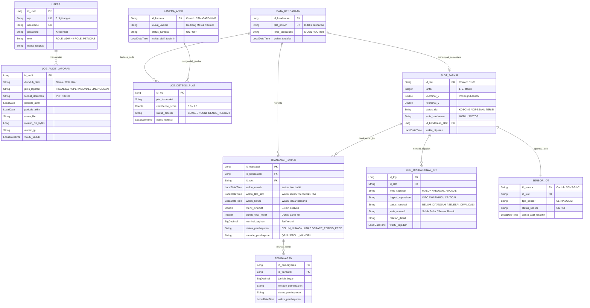

# 05. Model Entitas JPA, Enumerasi, dan Layer Repository Backend SPCT

Dokumentasi ini menyajikan pemetaan skema basis data PostgreSQL (`db_spct_iot`), struktur **Entitas JPA** (`com.spct.model`), tipe data **Enumerasi**, serta kueri-kueri khusus pada antarmuka **Repository** (`com.spct.repository`).

---

## 1. Diagram Relasi Entitas (Entity-Relationship Diagram / ERD)



---

## 2. Rincian Entitas Model JPA (`com.spct.model`)

### 2.1. `TransaksiParkir.java` (Entitas Inti Transaksi)
Berkas: [`TransaksiParkir.java`](file:///d:/Proyek%20Perangkat%20Lunak/Aplikasi/Desktop/Sistem%20Parkir%20Cerdas%20Terintegrasi%20IoT/backend-spring/src/main/java/com/spct/model/TransaksiParkir.java)
- **Tabel**: `transaksi_parkir`
- **Anotasi Kunci**:
  - `@ManyToOne @JoinColumn(name = "id_kendaraan")`: Relasi ke master plat nomor kendaraan.
  - `@ManyToOne @JoinColumn(name = "id_slot")`: Relasi ke slot fisik yang dialokasikan.
  - `@Enumerated(EnumType.STRING)` pada `statusPembayaran` dan `metodePembayaran` agar nilai enum tersimpan berupa teks yang mudah dibaca di SQL.
  - `waktuTibaSlot` & `menitDihemat`: Kolom empiris pencatat kedatangan fisik kendaraan di slot untuk menghitung metrik reduksi emisi CO2.

### 2.2. `SlotParkir.java` (Entitas Fisik Slot)
Berkas: [`SlotParkir.java`](file:///d:/Proyek%20Perangkat%20Lunak/Aplikasi/Desktop/Sistem%20Parkir%20Cerdas%20Terintegrasi%20IoT/backend-spring/src/main/java/com/spct/model/SlotParkir.java)
- **Tabel**: `slot_parkir`
- **Primary Key**: `idSlot` (String bertipe Alfanumerik, misal `"B1-01"` hingga `"M3-16"`).
- **Atribut Kunci**:
  - `lantai` (Integer: 1, 2, 3), `koordinatX` & `koordinatY` (Double).
  - `statusSlot`: Enumerasi `KOSONG`, `DIPESAN`, `TERISI`.
  - `kendaraanAktif`: Relasi opsional `@ManyToOne` ke kendaraan yang sedang memesan/mengisi slot.

### 2.3. `LogOperasionalIoT.java` (Entitas Telemetri & Anomali)
Berkas: [`LogOperasionalIoT.java`](file:///d:/Proyek%20Perangkat%20Lunak/Aplikasi/Desktop/Sistem%20Parkir%20Cerdas%20Terintegrasi%20IoT/backend-spring/src/main/java/com/spct/model/LogOperasionalIoT.java)
- **Tabel**: `log_operasional_iot`
- **Atribut Kunci**:
  - `tingkatKeparahan`: `INFO` (event normal), `WARNING`, `CRITICAL` (anomali penyerobotan).
  - `statusResolusi`: `BELUM_DITANGANI` (perlu tindakan petugas), `SELESAI_DIVALIDASI`.
  - `jenisAnomali`: Kategori resolusi yang diinput petugas (misal `"Salah Parkir"`, `"Sensor Rusak"`).

### 2.4. `User.java` (Entitas Kredensial Staf)
Berkas: [`User.java`](file:///d:/Proyek%20Perangkat%20Lunak/Aplikasi/Desktop/Sistem%20Parkir%20Cerdas%20Terintegrasi%20IoT/backend-spring/src/main/java/com/spct/model/User.java)
- **Tabel**: `users`
- **Atribut Kunci**:
  - `nip`: Nomor Induk Pegawai unik (8 digit angka). Digunakan sebagai kredensial login utama dan verifikasi reset kata sandi.
  - `username`: Nama pengguna alternatif.
  - `role`: Peran hak akses (`ROLE_MANAJEMEN_RS`, `ROLE_PETUGAS_LAPANGAN`).

---

## 3. Enumerasi Sistem (`com.spct.model`)

| Nama Enum | Nilai-Nilai (*Constant Values*) | Fungsi Bisnis |
| :--- | :--- | :--- |
| `JenisKendaraan` | `MOBIL`, `MOTOR` | Menentukan zona alokasi slot (B1..B3 untuk mobil, M1..M3 untuk motor) dan batas gerbang antrean. |
| `StatusSlot` | `KOSONG`, `DIPESAN`, `TERISI` | Status siklus hidup slot. `DIPESAN` mencegah balapan alokasi (*race condition*). |
| `StatusPembayaran` | `BELUM_LUNAS`, `LUNAS`, `GRACE_PERIOD_FREE` | Status tagihan. `GRACE_PERIOD_FREE` menandai parkir <=10 menit bebas biaya. |
| `MetodePembayaran` | `QRIS`, `ETOLL_MANDIRI`, `ETOLL_BRI`, `ETOLL_BCA` | Pilihan metode non-tunai saat transaksi selesai di Kiosk keluar. |
| `JenisKejadian` | `SENSOR_MENDETEKSI_MOBIL_MASUK`<br>`SENSOR_MENDETEKSI_MOBIL_KELUAR`<br>`ANOMALI_PENYEROBOTAN_SLOT` | Jenis event telemetri yang dilaporkan oleh IoT Gateway. |
| `TingkatKeparahan` | `INFO`, `WARNING`, `CRITICAL` | Bobot insiden. `INFO` dihapus otomatis setelah 90 hari, sedangkan `CRITICAL` dipertahankan 1 tahun. |
| `StatusResolusi` | `BELUM_DITANGANI`<br>`SEDANG_DITANGANI`<br>`SELESAI_DIVALIDASI` | Status alur kerja (*workflow*) penanganan insiden penyerobotan oleh petugas lapangan. |

---

## 4. Layer Repository & Kueri JPQL Kustom (`com.spct.repository`)

### 4.1. `TransaksiParkirRepository.java`
Berkas: [`TransaksiParkirRepository.java`](file:///d:/Proyek%20Perangkat%20Lunak/Aplikasi/Desktop/Sistem%20Parkir%20Cerdas%20Terintegrasi%20IoT/backend-spring/src/main/java/com/spct/repository/TransaksiParkirRepository.java)

Menyediakan kueri analitik finansial, kalkulasi emisi, dan antrean FIFO:

1. **Total Pendapatan Dalam Rentang Waktu (JPQL)**:
   ```java
   @Query("SELECT SUM(t.nominalTagihan) FROM TransaksiParkir t WHERE t.waktuKeluar BETWEEN :awal AND :akhir AND t.statusPembayaran = com.spct.model.StatusPembayaran.LUNAS")
   BigDecimal hitungTotalPendapatanDalamRentangWaktu(@Param("awal") LocalDateTime awal, @Param("akhir") LocalDateTime akhir);
   ```
2. **Kalkulasi Menit Dihemat Dari Sensor Riil (Green-IoT)**:
   ```java
   @Query("SELECT SUM(t.menitDihemat) FROM TransaksiParkir t WHERE t.menitDihemat IS NOT NULL")
   Double hitungTotalMenitDihematDariSensor();
   ```
3. **Pencarian Antrean Keluar FIFO Berdasarkan Jenis Kendaraan**:
   ```java
   List<TransaksiParkir> findByStatusPembayaranAndKendaraan_JenisKendaraanOrderByWaktuMasukAsc(
       StatusPembayaran status, JenisKendaraan jenisKendaraan);
   ```

### 4.2. `LogOperasionalIoTRepository.java`
Berkas: [`LogOperasionalIoTRepository.java`](file:///d:/Proyek%20Perangkat%20Lunak/Aplikasi/Desktop/Sistem%20Parkir%20Cerdas%20Terintegrasi%20IoT/backend-spring/src/main/java/com/spct/repository/LogOperasionalIoTRepository.java)

Menyediakan kueri manajemen anomali dan eksekusi retensi data:

1. **Pembersihan Log Retensi 90 Hari (Hanya Log INFO)**:
   ```java
   @Modifying
   @Query("DELETE FROM LogOperasionalIoT l WHERE l.waktuKejadian < :cutoff AND l.tingkatKeparahan = :keparahan")
   long deleteByWaktuKejadianBeforeAndTingkatKeparahan(
       @Param("cutoff") LocalDateTime cutoff, 
       @Param("keparahan") TingkatKeparahan keparahan);
   ```
2. **Kueri Menghitung Jumlah Anomali Aktif**:
   ```java
   Long countByStatusResolusi(StatusResolusi status);
   ```

### 4.3. `SlotParkirRepository.java`
Berkas: [`SlotParkirRepository.java`](file:///d:/Proyek%20Perangkat%20Lunak/Aplikasi/Desktop/Sistem%20Parkir%20Cerdas%20Terintegrasi%20IoT/backend-spring/src/main/java/com/spct/repository/SlotParkirRepository.java)

Pencarian slot kosong terdekat untuk algoritma BFS:
```java
List<SlotParkir> findByStatusSlotAndLantaiAndJenisKendaraanOrderByKoordinatXAsc(
    StatusSlot statusSlot, Integer lantai, JenisKendaraan jenisKendaraan);
```

### 4.4. `UserRepository.java`
Berkas: [`UserRepository.java`](file:///d:/Proyek%20Perangkat%20Lunak/Aplikasi/Desktop/Sistem%20Parkir%20Cerdas%20Terintegrasi%20IoT/backend-spring/src/main/java/com/spct/repository/UserRepository.java)

Pencarian kredensial staf berbasis NIP unik atau Username:
```java
Optional<User> findByNip(String nip);
Optional<User> findByUsername(String username);
```

### 4.5. `LogAuditLaporanRepository.java`
Berkas: [`LogAuditLaporanRepository.java`](file:///d:/Proyek%20Perangkat%20Lunak/Aplikasi/Desktop/Sistem%20Parkir%20Cerdas%20Terintegrasi%20IoT/backend-spring/src/main/java/com/spct/repository/LogAuditLaporanRepository.java)

Mengambil 15 data riwayat unduhan laporan terakhir untuk audit akuntabilitas:
```java
List<LogAuditLaporan> findTop15ByOrderByWaktuUnduhDesc();
```
