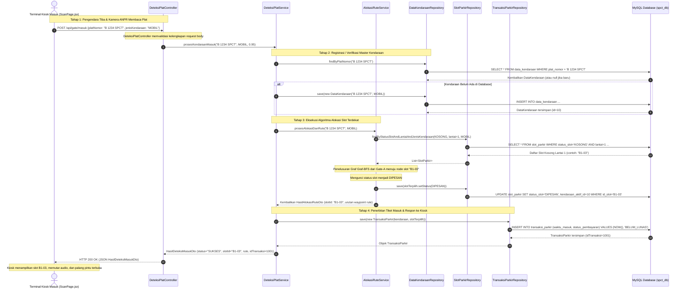
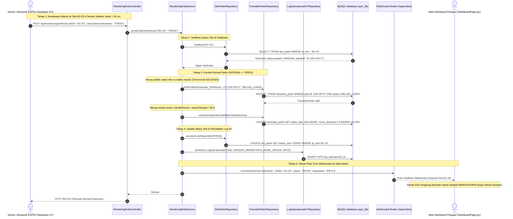
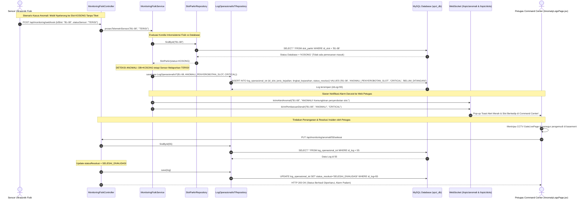
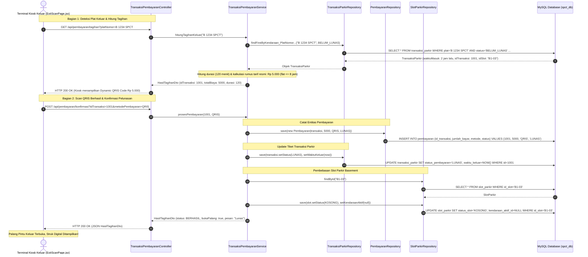

# 📊 Diagram Sequence Alur Program Sistem Parkir Cerdas Terintegrasi IoT (SPCT)
## Pemetaan Lengkap Alur MVC & End-to-End untuk 4 Mahasiswa (Siap Pakai di Draw.io)

Dokumen ini berisi **4 Sequence Diagram lengkap** yang memvisualisasikan interaksi nyata antarlayer sistem:
$$\text{Frontend / IoT Hardware} \longrightarrow \text{Controller} \longrightarrow \text{Service} \longrightarrow \text{Repository} \longrightarrow \text{Model / Entity} \longleftrightarrow \text{Database MySQL}$$

Setiap diagram merepresentasikan ruang lingkup tanggung jawab use case dari masing-masing mahasiswa dalam tim.

---

> [!TIP]
> ### 🎨 Cara Memasukkan Kode Ini Langsung ke Draw.io (app.diagrams.net):
> 1. Buka aplikasi **Draw.io** di desktop atau peramban ([app.diagrams.net](https://app.diagrams.net)).
> 2. Pada menu bar atas, klik **Arrange** (*Atur*) $\rightarrow$ **Insert** (*Sisipkan*) $\rightarrow$ **Advanced** (*Tingkat Lanjut*) $\rightarrow$ **Mermaid**.
> 3. Hapus teks contoh bawaan Draw.io, lalu **Copy & Paste salah satu blok kode sequence di bawah** (dari baris `sequenceDiagram` sampai baris terakhir kode diagram).
> 4. Klik tombol **Insert** (*Sisipkan*).
> 5. Diagram interaktif beresolusi tinggi akan langsung terbentuk secara otomatis dan dapat Anda ubah warna tema, font, maupun ukurannya sesuai selera presentasi!

---

## 📑 Daftar Isi Diagram

1. [Mahasiswa 1: Alur Gerbang Masuk, ANPR & Alokasi Slot Otomatis (PK-UC001 & PK-UC002)](#1-mahasiswa-1-alur-gerbang-masuk-anpr--alokasi-slot-otomatis-pk-uc001--pk-uc002)
2. [Mahasiswa 2: Alur Navigasi Kiosk & Telemetri Sensor IoT Real-Time (PK-UC003 & PK-UC004)](#2-mahasiswa-2-alur-navigasi-kiosk--telemetri-sensor-iot-real-time-pk-uc003--pk-uc004)
3. [Mahasiswa 3: Alur Deteksi Anomali Lapangan & Command Center Petugas (PK-UC005 & PK-UC009)](#3-mahasiswa-3-alur-deteksi-anomali-lapangan--command-center-petugas-pk-uc005--pk-uc009)
4. [Mahasiswa 4: Alur Gerbang Keluar, Pembayaran Cashless QRIS & Laporan Eksekutif (PK-UC006, 007, 008, 010)](#4-mahasiswa-4-alur-gerbang-keluar-pembayaran-cashless-qris--laporan-eksekutif-pk-uc006-007-008-010)

---

## 1. Mahasiswa 1: Alur Gerbang Masuk, ANPR & Alokasi Slot Otomatis (PK-UC001 & PK-UC002)

### Fokus Tanggung Jawab:
- **PK-UC001: Deteksi Plat Nomor & Klasifikasi (ANPR OCR)**
- **PK-UC002: Alokasi Slot Otomatis (Algoritma Penelusuran Slot Terdekat)**
- **Berkas Terkait**:
  - View: [`ScanPage.jsx`](file:///d:/Proyek%20Perangkat%20Lunak/Aplikasi/Desktop/Sistem%20Parkir%20Cerdas%20Terintegrasi%20IoT/frontend-kiosk/src/pages/ScanPage.jsx), [`AllocatingSlotPage.jsx`](file:///d:/Proyek%20Perangkat%20Lunak/Aplikasi/Desktop/Sistem%20Parkir%20Cerdas%20Terintegrasi%20IoT/frontend-kiosk/src/pages/AllocatingSlotPage.jsx)
  - Controller: [`DeteksiPlatController.java`](file:///d:/Proyek%20Perangkat%20Lunak/Aplikasi/Desktop/Sistem%20Parkir%20Cerdas%20Terintegrasi%20IoT/backend-spring/src/main/java/com/spct/controller/DeteksiPlatController.java) (`POST /api/gate/masuk`)
  - Service: [`DeteksiPlatService.java`](file:///d:/Proyek%20Perangkat%20Lunak/Aplikasi/Desktop/Sistem%20Parkir%20Cerdas%20Terintegrasi%20IoT/backend-spring/src/main/java/com/spct/service/DeteksiPlatService.java), [`AlokasiRuteService.java`](file:///d:/Proyek%20Perangkat%20Lunak/Aplikasi/Desktop/Sistem%20Parkir%20Cerdas%20Terintegrasi%20IoT/backend-spring/src/main/java/com/spct/service/AlokasiRuteService.java)
  - Repository: [`DataKendaraanRepository.java`](file:///d:/Proyek%20Perangkat%20Lunak/Aplikasi/Desktop/Sistem%20Parkir%20Cerdas%20Terintegrasi%20IoT/backend-spring/src/main/java/com/spct/repository/DataKendaraanRepository.java), [`SlotParkirRepository.java`](file:///d:/Proyek%20Perangkat%20Lunak/Aplikasi/Desktop/Sistem%20Parkir%20Cerdas%20Terintegrasi%20IoT/backend-spring/src/main/java/com/spct/repository/SlotParkirRepository.java), [`TransaksiParkirRepository.java`](file:///d:/Proyek%20Perangkat%20Lunak/Aplikasi/Desktop/Sistem%20Parkir%20Cerdas%20Terintegrasi%20IoT/backend-spring/src/main/java/com/spct/repository/TransaksiParkirRepository.java)
  - Model: [`DataKendaraan.java`](file:///d:/Proyek%20Perangkat%20Lunak/Aplikasi/Desktop/Sistem%20Parkir%20Cerdas%20Terintegrasi%20IoT/backend-spring/src/main/java/com/spct/model/DataKendaraan.java), [`SlotParkir.java`](file:///d:/Proyek%20Perangkat%20Lunak/Aplikasi/Desktop/Sistem%20Parkir%20Cerdas%20Terintegrasi%20IoT/backend-spring/src/main/java/com/spct/model/SlotParkir.java), [`TransaksiParkir.java`](file:///d:/Proyek%20Perangkat%20Lunak/Aplikasi/Desktop/Sistem%20Parkir%20Cerdas%20Terintegrasi%20IoT/backend-spring/src/main/java/com/spct/model/TransaksiParkir.java)

### 📌 Salin Kode Ini ke Draw.io (Mahasiswa 1):



---

## 2. Mahasiswa 2: Alur Navigasi Kiosk & Telemetri Sensor IoT Real-Time (PK-UC003 & PK-UC004)

### Fokus Tanggung Jawab:
- **PK-UC003: Panduan Rute Visual Kiosk (Denah Interaktif SVG & Waypoint Node)**
- **PK-UC004: Telemetri Ultrasonik & Emisi CO2 (Validasi Fisik Kendaraan Tiba)**
- **Berkas Terkait**:
  - View: [`NavigationPage.jsx`](file:///d:/Proyek%20Perangkat%20Lunak/Aplikasi/Desktop/Sistem%20Parkir%20Cerdas%20Terintegrasi%20IoT/frontend-kiosk/src/pages/NavigationPage.jsx), [`DashboardPage.jsx`](file:///d:/Proyek%20Perangkat%20Lunak/Aplikasi/Desktop/Sistem%20Parkir%20Cerdas%20Terintegrasi%20IoT/frontend-web/src/pages/DashboardPage.jsx)
  - Controller: [`MonitoringFisikController.java`](file:///d:/Proyek%20Perangkat%20Lunak/Aplikasi/Desktop/Sistem%20Parkir%20Cerdas%20Terintegrasi%20IoT/backend-spring/src/main/java/com/spct/controller/MonitoringFisikController.java) (`GET /api/monitoring/slots`, `POST /api/monitoring/webhook`)
  - Service: [`MonitoringFisikService.java`](file:///d:/Proyek%20Perangkat%20Lunak/Aplikasi/Desktop/Sistem%20Parkir%20Cerdas%20Terintegrasi%20IoT/backend-spring/src/main/java/com/spct/service/MonitoringFisikService.java)
  - Repository: [`SlotParkirRepository.java`](file:///d:/Proyek%20Perangkat%20Lunak/Aplikasi/Desktop/Sistem%20Parkir%20Cerdas%20Terintegrasi%20IoT/backend-spring/src/main/java/com/spct/repository/SlotParkirRepository.java), [`TransaksiParkirRepository.java`](file:///d:/Proyek%20Perangkat%20Lunak/Aplikasi/Desktop/Sistem%20Parkir%20Cerdas%20Terintegrasi%20IoT/backend-spring/src/main/java/com/spct/repository/TransaksiParkirRepository.java), [`LogOperasionalIoTRepository.java`](file:///d:/Proyek%20Perangkat%20Lunak/Aplikasi/Desktop/Sistem%20Parkir%20Cerdas%20Terintegrasi%20IoT/backend-spring/src/main/java/com/spct/repository/LogOperasionalIoTRepository.java)
  - Push Protocol: **Spring STOMP WebSocket** (`/topic/slots`)

### 📌 Salin Kode Ini ke Draw.io (Mahasiswa 2):



---

## 3. Mahasiswa 3: Alur Deteksi Anomali Lapangan & Command Center Petugas (PK-UC005 & PK-UC009)

### Fokus Tanggung Jawab:
- **PK-UC005: Deteksi Anomali Parkir (Penyerobotan Slot / Mobil Salah Parkir)**
- **PK-UC009: Command Center Petugas, Live Feed Kamera & Resolusi Insiden**
- **Berkas Terkait**:
  - View: [`AnomalyLogsPage.jsx`](file:///d:/Proyek%20Perangkat%20Lunak/Aplikasi/Desktop/Sistem%20Parkir%20Cerdas%20Terintegrasi%20IoT/frontend-web/src/pages/AnomalyLogsPage.jsx), [`GateLivePage.jsx`](file:///d:/Proyek%20Perangkat%20Lunak/Aplikasi/Desktop/Sistem%20Parkir%20Cerdas%20Terintegrasi%20IoT/frontend-web/src/pages/GateLivePage.jsx)
  - Controller: [`MonitoringFisikController.java`](file:///d:/Proyek%20Perangkat%20Lunak/Aplikasi/Desktop/Sistem%20Parkir%20Cerdas%20Terintegrasi%20IoT/backend-spring/src/main/java/com/spct/controller/MonitoringFisikController.java), [`HardwareStatusController.java`](file:///d:/Proyek%20Perangkat%20Lunak/Aplikasi/Desktop/Sistem%20Parkir%20Cerdas%20Terintegrasi%20IoT/backend-spring/src/main/java/com/spct/controller/HardwareStatusController.java)
  - Service: [`MonitoringFisikService.java`](file:///d:/Proyek%20Perangkat%20Lunak/Aplikasi/Desktop/Sistem%20Parkir%20Cerdas%20Terintegrasi%20IoT/backend-spring/src/main/java/com/spct/service/MonitoringFisikService.java)
  - Repository: [`LogOperasionalIoTRepository.java`](file:///d:/Proyek%20Perangkat%20Lunak/Aplikasi/Desktop/Sistem%20Parkir%20Cerdas%20Terintegrasi%20IoT/backend-spring/src/main/java/com/spct/repository/LogOperasionalIoTRepository.java), [`SlotParkirRepository.java`](file:///d:/Proyek%20Perangkat%20Lunak/Aplikasi/Desktop/Sistem%20Parkir%20Cerdas%20Terintegrasi%20IoT/backend-spring/src/main/java/com/spct/repository/SlotParkirRepository.java)
  - Model: [`LogOperasionalIoT.java`](file:///d:/Proyek%20Perangkat%20Lunak/Aplikasi/Desktop/Sistem%20Parkir%20Cerdas%20Terintegrasi%20IoT/backend-spring/src/main/java/com/spct/model/LogOperasionalIoT.java), [`TingkatKeparahan.java`](file:///d:/Proyek%20Perangkat%20Lunak/Aplikasi/Desktop/Sistem%20Parkir%20Cerdas%20Terintegrasi%20IoT/backend-spring/src/main/java/com/spct/model/TingkatKeparahan.java), [`StatusResolusi.java`](file:///d:/Proyek%20Perangkat%20Lunak/Aplikasi/Desktop/Sistem%20Parkir%20Cerdas%20Terintegrasi%20IoT/backend-spring/src/main/java/com/spct/model/StatusResolusi.java)

### 📌 Salin Kode Ini ke Draw.io (Mahasiswa 3):



---

## 4. Mahasiswa 4: Alur Gerbang Keluar, Pembayaran Cashless QRIS & Laporan Eksekutif (PK-UC006, 007, 008, 010)

### Fokus Tanggung Jawab:
- **PK-UC006: Deteksi Plat Nomor Keluar & Kalkulasi Tarif Otomatis**
- **PK-UC007 & PK-UC008: Pembayaran Digital QRIS Nirkontak & Pembukaan Palang Keluar**
- **PK-UC010: Analitik Finansial & Pembuatan Laporan Resmi PDF/Excel**
- **Berkas Terkait**:
  - View: [`ExitScanPage.jsx`](file:///d:/Proyek%20Perangkat%20Lunak/Aplikasi/Desktop/Sistem%20Parkir%20Cerdas%20Terintegrasi%20IoT/frontend-kiosk/src/pages/ExitScanPage.jsx), [`ReportsPage.jsx`](file:///d:/Proyek%20Perangkat%20Lunak/Aplikasi/Desktop/Sistem%20Parkir%20Cerdas%20Terintegrasi%20IoT/frontend-web/src/pages/ReportsPage.jsx), [`DashboardManagementPage.jsx`](file:///d:/Proyek%20Perangkat%20Lunak/Aplikasi/Desktop/Sistem%20Parkir%20Cerdas%20Terintegrasi%20IoT/frontend-web/src/pages/DashboardManagementPage.jsx)
  - Controller: [`TransaksiPembayaranController.java`](file:///d:/Proyek%20Perangkat%20Lunak/Aplikasi/Desktop/Sistem%20Parkir%20Cerdas%20Terintegrasi%20IoT/backend-spring/src/main/java/com/spct/controller/TransaksiPembayaranController.java), [`LaporanController.java`](file:///d:/Proyek%20Perangkat%20Lunak/Aplikasi/Desktop/Sistem%20Parkir%20Cerdas%20Terintegrasi%20IoT/backend-spring/src/main/java/com/spct/controller/LaporanController.java)
  - Service: [`TransaksiPembayaranService.java`](file:///d:/Proyek%20Perangkat%20Lunak/Aplikasi/Desktop/Sistem%20Parkir%20Cerdas%20Terintegrasi%20IoT/backend-spring/src/main/java/com/spct/service/TransaksiPembayaranService.java), [`LaporanPdfService.java`](file:///d:/Proyek%20Perangkat%20Lunak/Aplikasi/Desktop/Sistem%20Parkir%20Cerdas%20Terintegrasi%20IoT/backend-spring/src/main/java/com/spct/service/LaporanPdfService.java)
  - Repository: [`TransaksiParkirRepository.java`](file:///d:/Proyek%20Perangkat%20Lunak/Aplikasi/Desktop/Sistem%20Parkir%20Cerdas%20Terintegrasi%20IoT/backend-spring/src/main/java/com/spct/repository/TransaksiParkirRepository.java), [`PembayaranRepository.java`](file:///d:/Proyek%20Perangkat%20Lunak/Aplikasi/Desktop/Sistem%20Parkir%20Cerdas%20Terintegrasi%20IoT/backend-spring/src/main/java/com/spct/repository/PembayaranRepository.java), [`SlotParkirRepository.java`](file:///d:/Proyek%20Perangkat%20Lunak/Aplikasi/Desktop/Sistem%20Parkir%20Cerdas%20Terintegrasi%20IoT/backend-spring/src/main/java/com/spct/repository/SlotParkirRepository.java), [`LogAuditLaporanRepository.java`](file:///d:/Proyek%20Perangkat%20Lunak/Aplikasi/Desktop/Sistem%20Parkir%20Cerdas%20Terintegrasi%20IoT/backend-spring/src/main/java/com/spct/repository/LogAuditLaporanRepository.java)

### 📌 Salin Kode Ini ke Draw.io (Mahasiswa 4):



### 📌 Salin Kode Ini ke Draw.io untuk Alur Ekspor Laporan PDF/Excel & Audit Trail (Mahasiswa 4 Bagian Lanjutan):

```mermaid
sequenceDiagram
    autonumber
    actor Direksi as Web Admin / Manajer (ReportsPage.jsx)
    participant C_Lap as LaporanController
    participant S_Pdf as LaporanPdfService
    participant R_Tx as TransaksiParkirRepository
    participant R_Audit as LogAuditLaporanRepository
    participant DB as MySQL Database (spct_db)

    Note over Direksi,C_Lap: Permintaan Unduh Laporan Finansial Resmi Bulanan
    Direksi->>C_Lap: GET /api/laporan/unduh?format=pdf&dari=2026-10-01&sampai=2026-10-31
    C_Lap->>S_Pdf: buatDokumenPdf("finansial", dari, sampai)
    
    Note over S_Pdf,R_Tx: Agregasi Data Transaksi Finansial
    S_Pdf->>R_Tx: findTransaksiLunasPeriode(dari, sampai)
    R_Tx->>DB: SELECT * FROM transaksi_parkir WHERE status_pembayaran='LUNAS' AND waktu_masuk BETWEEN ...
    DB-->>R_Tx: List Transaksi & Agregasi Total Pendapatan Rp 42.500.000
    R_Tx-->>S_Pdf: List<TransaksiParkir>
    
    Note over S_Pdf: Kompilasi Dokumen PDF (iText / OpenPDF Engine)
    Note over S_Pdf: Menghasilkan binary byte[] PDF ber-watermark resmi RS

    Note over C_Lap,R_Audit: Pencatatan Jejak Audit Trail (Compliance & Keamanan)
    C_Lap->>R_Audit: save(new LogAuditLaporan(adminUser, "UNDUH_PDF_FINANSIAL", IPAddress, timestamp))
    R_Audit->>DB: INSERT INTO log_audit_laporan ...

    C_Lap-->>Direksi: HTTP 200 OK (Content-Type: application/pdf, Content-Disposition: attachment; filename="Laporan_SPCT_202610.pdf")
    Note over Direksi: Berkas PDF otomatis terunduh di browser pengguna
```

---

## 5. Ringkasan Prinsip Arsitektur MVC SPCT

Bila dosen bertanya mengenai filosofi pembagian kode MVC di sistem SPCT, jelaskan prinsip 5 poin ini:

```
[ Antarmuka Frontend / Sensor IoT ]
               │
               ▼  (HTTP Request / REST Endpoint)
   [ Controller: com.spct.controller ]
   Tugas: Menerima HTTP, validasi parameter input, routing response
               │
               ▼  (Method Call)
     [ Service: com.spct.service ]
   Tugas: Jantung logika bisnis, algoritma A*, hitung tarif, transaksi DB
          │                        │
          ▼                        ▼
  [ DTO: com.spct.dto ]   [ Repository: com.spct.repository ]
  Tugas: Bungkus payload  Tugas: Query SQL Spring Data JPA
                                   │
                                   ▼
                          [ Model: com.spct.model ]
                          Tugas: Entitas relasional tabel MySQL
                                   │
                                   ▼
                         [ Database: MySQL spct_db ]
```

1. **Frontend / IoT**: Bertindak sebagai pemicu (*Trigger*). Tidak boleh tahu struktur tabel basis data.
2. **Controller**: Gerbang penjaga pintu masuk HTTP (*Gatekeeper*). Bertugas mengolah request dari URL endpoint dan mengembalikan respon JSON/Berkas.
3. **Service**: Pusat komputasi (*Brain*). Seluruh kalkulasi algoritma (A*, BFS, tarif parkir, reduksi emisi CO2, deteksi penyerobotan) berada di layer ini.
4. **Repository**: Jembatan data (*Data Access*). Berisi interface Spring Data JPA yang mengubah instruksi Java menjadi query SQL native MySQL secara otomatis.
5. **Model & DTO**: Struktur data (*Data Contract*). Model mencerminkan tabel fisik database, sedangkan DTO bertugas sebagai wadah pembungkus data kiriman bolak-balik antara frontend dan backend.
