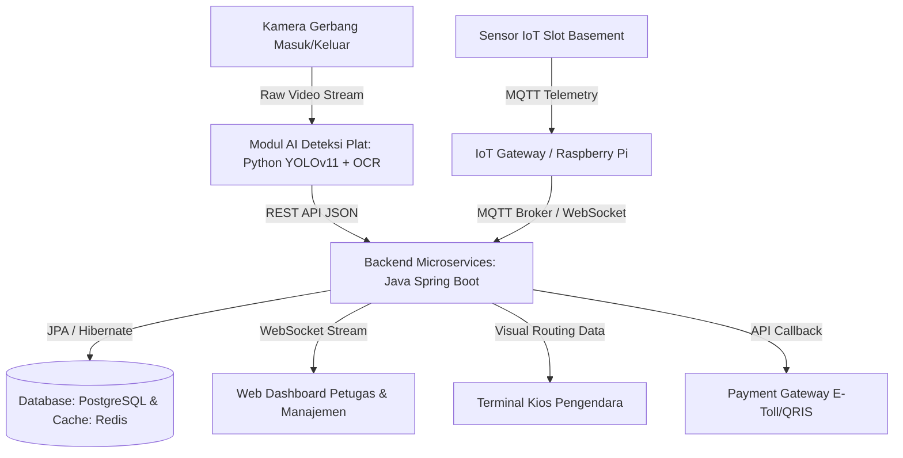

<div align="center">

# Sistem Parkir Cerdas Terintegrasi IoT (SPCT IoT)

**Green-IoT Integrated Smart Parking System with AI-Powered ALPR & Real-Time Navigation**

[](https://spring.io/projects/spring-boot)
[](https://github.com/ultralytics/ultralytics)
[](#arsitektur-sistem)
[](#desain-antarmuka-uiux)

</div>

---

## 📌 Gambaran Umum (Overview)

**Sistem Parkir Cerdas Terintegrasi IoT (SPCT IoT)** adalah solusi otomasi manajemen parkir modern yang dirancang khusus untuk fasilitas publik berkepadatan tinggi (seperti Rumah Sakit dan Pusat Perbelanjaan). 

Berbeda dengan sistem konvensional, SPCT IoT menggabungkan arsitektur **Microservices (Java Spring Boot)**, **Computer Vision (Python YOLOv11 + OCR)**, dan **Sensor Internet of Things (IoT)** untuk menghadirkan ekosistem parkir tanpa karcis (*paperless*), navigasi slot presisi, serta pemantauan emisi gas buang (CO2) di area ruang tertutup (*basement*).

---

## 🌍 Latar Belakang & Permasalahan

Sistem ini dikembangkan berdasarkan analisis kerangka kerja **PIECES** terhadap masalah harian di area parkir:
1. **Pemborosan Waktu & BBM:** Pengendara menghabiskan waktu lama memutari area *basement* hanya untuk mencari slot kosong.
2. **Polusi & Emisi Gas Buang:** Kendaraan yang terus menyala di ruang tertutup melepaskan akumulasi emisi berbahaya (CO2, gas buang, dan Particulate Matter PM 2.5).
3. **Limbah Karcis Kertas/Plastik:** Penggunaan tiket fisik menimbulkan limbah berkala, risiko kehilangan karcis (denda), serta biaya operasional printer termal.
4. **Ketiadaan Monitoring Real-Time:** Pengelola tidak memiliki data persebaran okupansi slot parkir yang terpusat dan akurat.
5. **Kemacetan Gerbang:** Proses verifikasi manual dan pembayaran tunai sering memicu *bottleneck* antrean di jam sibuk.

---

## ✨ Fitur Utama

- **AI-Powered ALPR (Automatic License Plate Recognition):** Deteksi posisi plat nomor kendaraan secara instan menggunakan **YOLOv11** dan ekstraksi teks menggunakan **OCR** di gerbang masuk dan keluar (< 3 detik).
- **Alokasi Slot Cerdas & Navigasi Graf (A* / Dijkstra):** Sistem memetakan area parkir sebagai struktur *Graph* (Node & Edge) untuk mengarahkan pengemudi langsung ke slot kosong terdekat via panduan visual terminal.
- **Pemantauan Okupansi IoT Real-Time:** Sensor fisik (Ultrasonik/Inframerah) memantau status slot (`Kosong`, `Dipesan`, `Terisi`) dan mengirimkan telemetri melalui protokol **MQTT**.
- **Deteksi Anomali & Pencegahan Efek Domino:** Peringatan dini jika terjadi salah parkir / penyerobotan slot tanpa alokasi, dengan fitur verifikasi visual bagi petugas lapangan.
- **Pembayaran Nirkontak (Cashless Gateway):** Integrasi pembayaran digital via E-Toll/QRIS lengkap dengan dukungan aturan *Grace Period* (Drop-Off gratis < 10 menit).
- **Kalkulator Reduksi Emisi CO2 (Eco-Metrics):** Menghitung estimasi emisi karbon yang berhasil dicegah berdasarkan selisih waktu pencarian parkir terpandu versus konvensional.
- **Role-Based Command Center:**
  - **Manajemen:** Dashboard analitik pendapatan kotor (*Revenue Tracker*) dan metrik lingkungan hidup (*CO2 Savings*).
  - **Petugas Lapangan:** Tampilan operasional taktis, pemantauan CCTV gerbang (*Gate OCR Feed*), dan log anomali (*Anomaly Logs*).

---

## 🏗️ Arsitektur Sistem

Sistem ini menerapkan konsep **Microservices** yang terdistribusi dan terhubung melalui jaringan lokal/intranet:



### 🛠️ Teknologi yang Digunakan

| Komponen | Teknologi | Keterangan |
| :--- | :--- | :--- |
| **Backend & Microservices** | Java (OOP), Spring Boot | Mengelola logika bisnis, autentikasi RBAC, alokasi rute, dan transaksi |
| **Computer Vision (AI)** | Python, YOLOv11, OpenCV, EasyOCR/Tesseract | Deteksi plat nomor kendaraan dan klasifikasi jenis kendaraan (Mobil/Motor) |
| **Database & Cache** | PostgreSQL, Redis | Penyimpanan transaksional ter-normalisasi (3NF) dan *caching* status slot |
| **IoT & Edge Gateway** | Raspberry Pi / ESP32, Protokol MQTT | Pembacaan sensor jarak fisik per slot parkir |
| **Komunikasi Real-Time** | WebSockets / Socket.IO | Sinkronisasi denah interaktif tanpa *refresh* (F5) |
| **Frontend / Back-Office** | React.js / Vue.js, Tailwind CSS | Antarmuka *Command Center* dengan tema *Dark Mode & Glassmorphism* |

---

## 🎨 Desain Antarmuka (UI/UX)

Antarmuka SPCT IoT mengusung gaya visual **Dark Mode (#121212 / #1E1E1E)** ala *Developer IDE* dengan aksen semantik:
- 🟢 **Nature Green (`#2E8B57`):** Slot tersedia, rute panduan, status transaksi lunas, metrik Eco-Impact positif.
- 🟡 **Warning Yellow (`#FFD700`):** Status slot sedang dipesan (*Reserved*) dalam perjalanan.
- 🔴 **Alert Red (`#FF4500`):** Anomali salah parkir, gangguan sensor (*timeout*), saldo kurang.
- 🔵 **Electric Blue (`#00BFFF`):** Status konektivitas sistem dan telemetri IoT.

---

## 📂 Struktur Repositori

```text
├── Rekayasa Perangkat Lunak/       # Sumber Diagram UML (Use Case, Aktivitas, MVC, Sequence, ERD)
├── Spesifikasi Sistem Parkir Cerdas/ # Panduan spesifikasi desain UI/UX dan prompt perancangan
├── Respon Antigravity/             # Dokumen analisis domain pemahaman dan strategi teknis
├── Contoh_Kode_Java/               # Prototipe lapisan Entity, Repository, Service, dan Controller Spring Boot
├── Evaluasi SPCT IoT.txt           # Catatan evaluasi mendalam dan penyelesaian Open Issues
└── Tahap_V_SistemParkirCerdas.pdf  # Dokumen laporan konseptual rekayasa perangkat lunak lengkap
```

---

## 🚀 Rencana Pengembangan Selanjutnya

- [x] Perancangan Konseptual Rekayasa Perangkat Lunak (Tahap I - V)
- [x] Implementasi Model AI YOLOv11 & OCR Deteksi Plat Nomor
- [ ] Implementasi Kerangka Dasar Microservices Java Spring Boot
- [ ] Pemetaan Graf Jalur Basement & Implementasi Algoritma A*
- [ ] Integrasi Broker MQTT & Simulator Sinyal Sensor IoT
- [ ] Pengembangan Antarmuka Web Dashboard (React/Tailwind)
- [ ] Pengujian Integrasi End-to-End (Masuk -> Alokasi -> Parkir -> Bayar Keluar)

---

## 👥 Tim Pengembang

Proyek ini disusun dan dikembangkan oleh mahasiswa **Program Studi Informatika, Fakultas Sains dan Teknologi, Universitas Sanata Dharma, Yogyakarta**:

- **Antonius Rimba Adiprihartanto** - 245314036
- **Ignatius Farrel Aditya Pratama** - 245314037
- **Yohanes Paskalis Rafllyno** - 245314038
- **Bintang Adistya Saputra** - 245314039

---

## 📄 Hak Cipta & Lisensi

© 2026 Universitas Sanata Dharma. **All Rights Reserved.**
Proyek ini adalah karya akademik tertutup. Hak cipta dilindungi sepenuhnya oleh tim pengembang. Dilarang menyalin, mendistribusikan, atau menggunakan kode dari repositori ini untuk keperluan komersial tanpa izin eksplisit.
